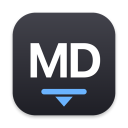
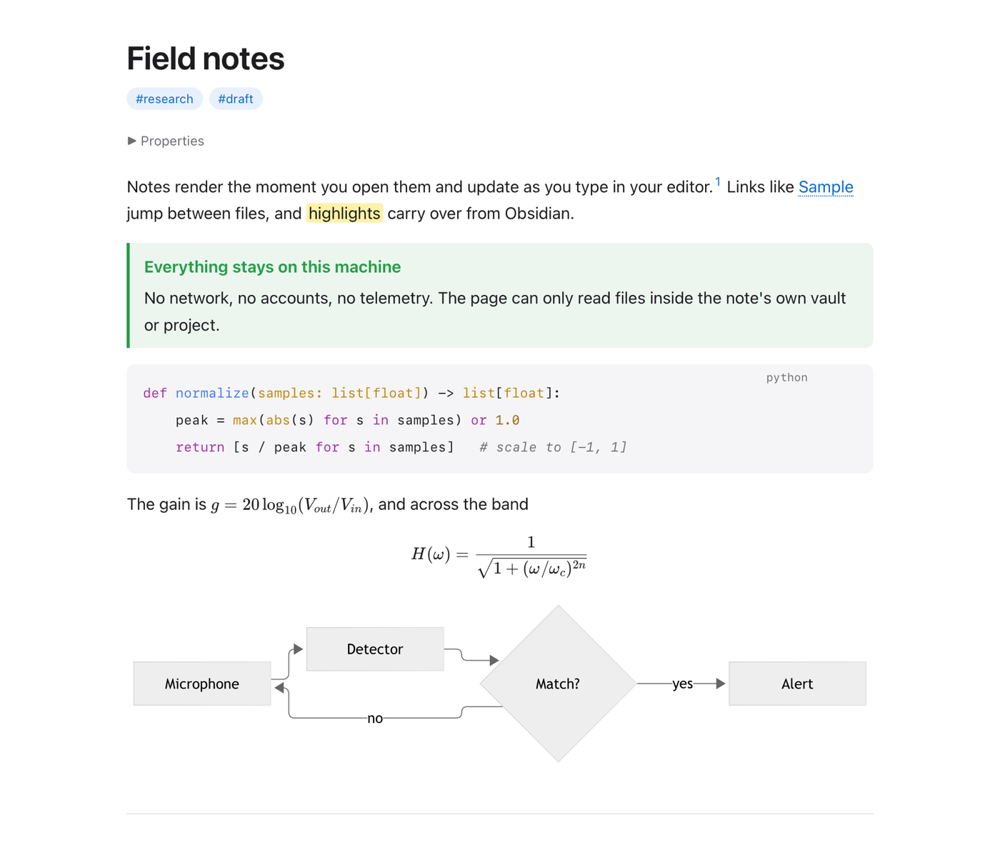

<p align="center">
  
</p>

<h1 align="center">mdview</h1>

<p align="center">
  <strong>A lightweight Markdown viewer for Mac and Linux.</strong><br>
  Opens instantly, re-renders as you type, and never touches the network.
</p>

<p align="center">
  <a href="https://github.com/PoggyBobby/mdview/actions/workflows/build.yml"></a>
  
  
  
  <a href="LICENSE"></a>
</p>

## Install

```sh
curl -fsSL https://raw.githubusercontent.com/PoggyBobby/mdview/main/install.sh | sh
```

That one line installs mdview and makes it the default app for `.md` files, on either platform.

| | macOS | Linux |
|---|---|---|
| **What you get** | `MDView.app` in `/Applications` plus a Quick Look extension, so Space in Finder previews Markdown | A GTK app under `~/.local`, a desktop entry for `text/markdown`, and a `mdview` command |
| **Needs** | macOS 13+, Xcode Command Line Tools (the installer offers to install them) | Python 3 with GTK 3 and WebKitGTK bindings (the installer adds them with apt, dnf, pacman, zypper or apk) |
| **Keep your current default** | `curl -fsSL …/install.sh \| sh -s -- --no-default` | same |
| **Uninstall** | `curl -fsSL …/install.sh \| sh -s -- --uninstall` | same |

Prefer to look first? Clone the repo and run `./install.sh`, or on macOS `./build.sh` to just build `build/MDView.app`.

<p align="center">
  <picture>
    <source media="(prefers-color-scheme: dark)" srcset="docs/screenshot-dark.png">
    
  </picture>
</p>

## Why mdview

- **Fast.** A 20,000-line document renders in about a quarter of a second. Files re-render in place when they change on disk, keeping your scroll position.
- **Private by construction.** No network access, no telemetry, no accounts. A document can only load files from inside its own vault or project, so a stray image link cannot read anything else on your disk.
- **One renderer, two platforms.** The macOS app and the Linux app run the same page runtime, so a note looks the same on both. Light and dark follow your system.
- **Obsidian-aware.** Wikilinks, embeds, highlights, callouts and front matter all work the way your vault expects.

## What it renders

| Writing | Code and figures | Obsidian and GitHub |
|---|---|---|
| GitHub-flavored Markdown: tables, task lists, strikethrough, autolinks | Syntax highlighting for 190+ languages, with a hover **Copy** button | `[[wikilinks]]` and `![[image.png\|300]]` embeds, found by name anywhere in the vault |
| Footnotes `[^1]` | Math with KaTeX: `$inline$` and `$$display$$` | `==highlights==` and callouts such as `> [!NOTE]` (GitHub alerts use the same syntax) |
| YAML front matter: `title` becomes the heading and window title, `tags` become chips, the rest collapses under **Properties** | Mermaid diagrams in ```` ```mermaid ```` blocks, loaded only when a document uses one | Raw HTML, with scripts, iframes and event handlers stripped |

## Everyday use

- **Outline sidebar** that follows your reading position.
- **Find** with match counts, next and previous.
- **Links** to other Markdown files open in a new window. Web links open in your browser. Other files open in their default app, except programs, scripts, bundles, disk images and installer packages, which are revealed in the file manager instead of launched.
- **Edit** hands the file to your editor; double-clicking empty space does the same.
- **Export** as a standalone HTML file with images and math fonts embedded, as PDF, or print.
- **Start page** with recent documents and a drop target when you launch without a file.
- **Scroll memory** per file, and zoom that sticks.

## Keyboard

| macOS | Linux | Action |
|---|---|---|
| ⌘O | Ctrl+O | Open a file |
| ⌘N | Ctrl+N | New window |
| ⌘F · ⌘G · ⇧⌘G | Ctrl+F · Ctrl+G · Ctrl+Shift+G | Find · next · previous |
| ⇧⌘O | Ctrl+Shift+O | Toggle the outline sidebar |
| ⌘+ · ⌘- · ⌘0 | Ctrl++ · Ctrl+- · Ctrl+0 | Zoom in · out · reset |
| ⌘R | Ctrl+R or F5 | Re-render |
| ⌘E | Ctrl+E | Edit in your editor |
| ⌥⌘R | Ctrl+Alt+R | Reveal in Finder · show in Files |
| ⇧⌘E | Ctrl+Shift+E | Export as HTML |
| ⇧⌘P | Ctrl+Shift+P | Export as PDF |
| ⌘P | Ctrl+P | Print |

## How it stays private

The page never sees a `file://` URL. The app serves everything through its own `mdview://` scheme: `mdview://app/` for the viewer's own files, and `mdview:///path` only for files inside the document's root. The root is the nearest folder containing `.obsidian`, `.git` or `.mdview-root`, or else the document's own folder. Anything outside it stays blank. Scripts and embedded frames from the document are stripped, and a content security policy blocks any network request the page could try to make.

<details>
<summary><strong>Linux packages</strong></summary>

The installer runs one of these for you. Install them yourself if you prefer:

| Distribution | Packages |
|---|---|
| Debian, Ubuntu | `python3 python3-gi python3-gi-cairo gir1.2-gtk-3.0 gir1.2-webkit2-4.1 xdg-utils` (`gir1.2-webkit2-4.0` also works) |
| Fedora | `python3-gobject python3-cairo gtk3 webkit2gtk4.1 xdg-utils` |
| Arch | `python-gobject python-cairo gtk3 webkit2gtk-4.1 xdg-utils` |
| openSUSE | `python3-gobject python3-gobject-cairo typelib-1_0-Gtk-3_0 typelib-1_0-WebKit2-4_1 xdg-utils` |
| Alpine | `python3 py3-gobject3 py3-cairo gtk+3.0 webkit2gtk-4.1 xdg-utils` |

Set `MDVIEW_PREFIX` to install somewhere other than `~/.local`.
</details>

<details>
<summary><strong>Settings</strong></summary>

macOS, with `defaults write one.sellab.mdview <key> <value>`:

| Key | Values | Meaning |
|---|---|---|
| `EditorApp` | app name, bundle id, or path | App used by ⌘E. Default: VS Code, Cursor, Zed, Sublime Text, BBEdit, Nova or TextEdit, whichever is installed first |
| `appearance` | `system`, `light`, `dark` | Same as the View menu |

Linux, in `~/.config/mdview/prefs.json`:

| Key | Values | Meaning |
|---|---|---|
| `editor` | a command, e.g. `"code"` | Used by Ctrl+E. Otherwise the default app for `text/plain`, then `$VISUAL` or `$EDITOR` |
| `appearance` | `system`, `light`, `dark` | Same as the menu |
</details>

<details>
<summary><strong>Command line</strong></summary>

```
mdview file.md            open a file (reuses the running app)
mdview --set-default      make mdview the default app for Markdown
mdview --which            print the current default app for Markdown
mdview --snapshot OUT f   render f to OUT (.png, .pdf or .html) and exit
```

`--snapshot` is what the test suite uses. `MDVIEW_SNAPSHOT_DELAY` (seconds) and, on macOS, `MDVIEW_SNAPSHOT_SIZE` (`WxH`) tune it.
</details>

<details>
<summary><strong>Building and project layout</strong></summary>

```
Sources/Shared/Core.swift       mdview:// scheme handler, root rules, page template, HTML export (macOS)
Sources/App/main.swift          windows, menus, file watching, link routing (macOS)
Sources/QuickLook/              Quick Look preview extension (macOS)
linux/mdview.py                 the GTK edition, same page runtime
linux/mdview.desktop            desktop entry template
Resources/viewer.html           page template and CSS
Resources/app.js                renderer setup, footnotes, math, mermaid, outline, find, start page
Resources/vendor/               bundled libraries and their licenses
samples/                        documents that exercise every supported feature
tests/make_large.py             generates big documents for timing
install.sh                      one-command installer for both platforms
build.sh                        macOS build: app, extension, ad-hoc signing, optional install
.github/workflows/build.yml     builds and renders on macOS and Linux for every push
```

macOS builds need only the Xcode Command Line Tools: `./build.sh` compiles the app and the Quick Look extension with `swiftc`, signs them ad hoc, and `--install` or `--default` copies the result to `/Applications`. The Linux edition is plain Python and runs straight from the checkout: `python3 linux/mdview.py file.md`.

Every push builds both editions and renders the sample document to PDF, PNG and HTML on macOS and Linux runners, then times a generated 20,000-line document.
</details>

<details>
<summary><strong>Performance</strong></summary>

| Document | Render time |
|---|---|
| 20,000 lines, 600 KB, 400 code blocks | about 250 ms |
| 100,000 lines, 3 MB | about 1.2 s |

Code blocks above 40,000 characters are shown without highlighting to keep that true. Mermaid is loaded only when a document contains a diagram.
</details>

## Credits

mdview bundles [marked](https://github.com/markedjs/marked) 18.1.1 (MIT), [highlight.js](https://github.com/highlightjs/highlight.js) 11.12.0 (BSD-3-Clause), [KaTeX](https://github.com/KaTeX/KaTeX) 0.19.1 (MIT) and [mermaid](https://github.com/mermaid-js/mermaid) 12.2.0 (MIT). Their license texts live in `Resources/vendor/`.

## License

[MIT](LICENSE)
