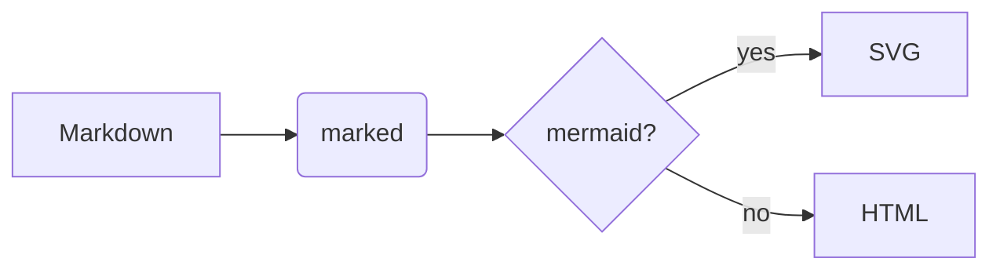

A paragraph with **bold**, *italic*, `inline code`, a [web link](https://example.com), a [[Other Note]] wikilink, a [relative file link](Other%20Note.md), ==highlighted text==, ~~strike~~, and a footnote.[^1] Another footnote[^note] with a longer name.

## Lists

- Item one
- Item two
  - Nested item
- [x] Done task
- [ ] Open task

1. First
2. Second

## Code

```swift
import AppKit
let app = NSApplication.shared   // comment
print("hello \(app)")
```

```dockerfile
FROM ubuntu:24.04
RUN apt-get update && apt-get install -y python3
```

## Table

| Name | Role | Notes |
|------|------|-------|
| Argus | Detection kit | open code |
| Aegis | Finance tool | local-first |

## Callouts and quotes

> [!NOTE]
> This is a note callout with `code`.

> [!WARNING] Custom title
> Be careful here.

> A plain blockquote.

## Math

Inline math like $E = mc^2$ and $\alpha + \beta$, prices like $5 and $10 stay text.

$$
\int_0^\infty e^{-x^2}\,dx = \frac{\sqrt{\pi}}{2}
$$

## Diagram



## Images


![[red.png|48]]

### Deep heading

Some text under a level-3 heading. Jump to [the top](#mdview-feature-tour).

<details><summary>Raw HTML details</summary>Hidden content. <script>document.title='XSS'</script></details>

---
Horizontal rule above. Press ⌘F to find "callout".

[^1]: The first footnote, with *emphasis*.
[^note]: A named footnote that spans
    two lines.
