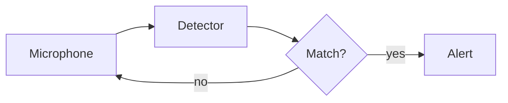

Notes render the moment you open them and update as you type in your editor.[^1] Links like [[Sample]] jump between files, and ==highlights== carry over from Obsidian.

> [!TIP] Everything stays on this machine
> No network, no accounts, no telemetry. The page can only read files inside the note's own vault or project.

```python
def normalize(samples: list[float]) -> list[float]:
    peak = max(abs(s) for s in samples) or 1.0
    return [s / peak for s in samples]   # scale to [-1, 1]
```

The gain is $g = 20\log_{10}(V_{out}/V_{in})$, and across the band

$$
H(\omega) = \frac{1}{\sqrt{1 + (\omega/\omega_c)^{2n}}}
$$



[^1]: Saved files are re-rendered in place, keeping your scroll position.
